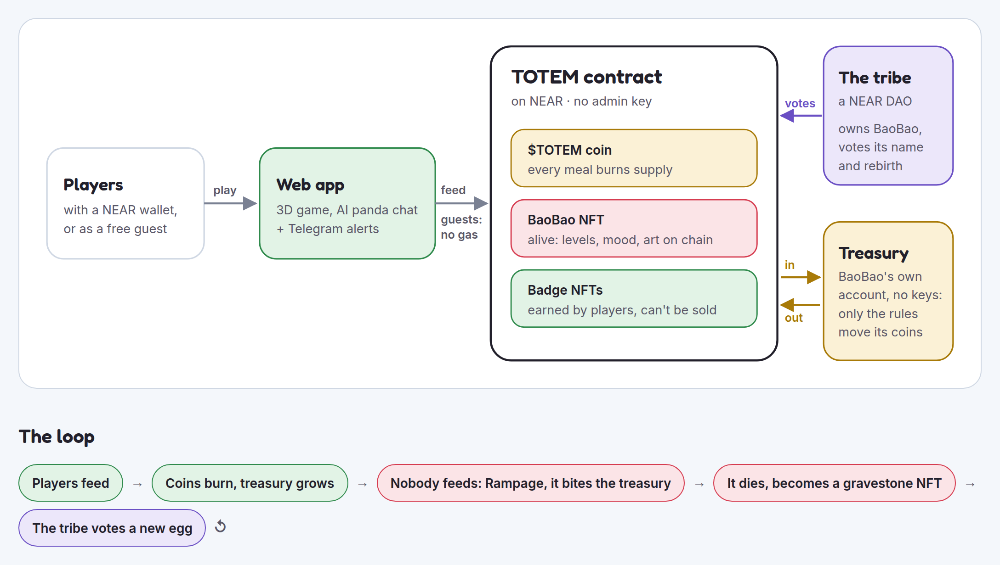

<div align="center">
  <h1>🐼 TOTEM — The Community Creature on NEAR</h1>
  <p>One shared NFT panda the whole tribe keeps alive by feeding it a memecoin.<br/>
  Neglect it and it eats the community treasury. Care for it and it pays you back.</p>
  <p>Built for <b>NEAR Hackathon (Nov 2026)</b> · Live on testnet, no wallet needed.</p>
  <br/>
  <a href="https://totem-x2kg.onrender.com"><strong>▶ Play now → totem-x2kg.onrender.com</strong></a>
  <br/><br/>


</div>

---



📸 **[View all screenshots →](docs/screenshots.md)**

## 🌟 Overview

TOTEM is a community creature — a single living NFT on NEAR that the whole tribe keeps alive by feeding it **$TOTEM**, a NEP-141 memecoin. Every meal burns half the tokens (deflating supply) and puts the rest into a treasury **the creature itself owns** through a keyless NEAR sub-account no one can sign for.

Neglect it and it enters a **Rampage**: biting the treasury, slashing stakers, and dropping levels every 90 seconds until it hits Level 0 and dies as a gravestone NFT. Rescue it and earn a soulbound **Hero badge**. Feed it consistently and earn **Blessings** — proportional payouts from the treasury.

The creature is named **BaoBao** (chosen by DAO vote). Every generation inherits cosmetic traits from the previous life's top feeders. The game has no admin key, all rules are fixed at launch, and every player — including wallet-less guests — can participate gaslessly.

---

## 💡 End-to-End Value Proposition

| Who | Scenario | What TOTEM enables |
| :--- | :--- | :--- |
| **🎮 The Casual Player** | Opens the app for the first time, no wallet | Taps "⚡ Play free" — a zero-balance NEAR account is silently created. Feeds bamboo, watches $TOTEM burn, earns points. No seed phrase, no gas prompt, no popup ever. |
| **💰 The Staker** | Holds 1,000 $TOTEM and wants passive yield | Stakes into BaoBao's belly. Feeds 5 tokens to shield the stake. When a Rampage happens, their stake is protected. After a Blessing period they claim a proportional payout from the treasury. |
| **🛡 The Rescuer** | Sees the tribe's Telegram alert "1 bite from death" | Taps the one-click rescue link. Even with 0 NEAR, a gasless meta-transaction (NEP-366) feeds BaoBao. A soulbound **Hero NFT** is minted to their account. |
| **🏛 The Keeper** | Has ≥ 1,000 staked or a Silver/Gold badge | Votes on DAO proposals: rename BaoBao, trigger an evolution, hatch the next egg. The DAO owns the Totem NFT; no one else can govern it. |
| **🔮 The Speculator** | Wants to bet on the next Rampage | Opens the Prediction Market during a Rampage. Bets $TOTEM on survive or die. Winners split 97% of the losing pool; 3% is burned. Market resolves on-chain automatically. |
| **🤖 The AI Visitor** | Talks to BaoBao in the chat panel | BaoBao reads its own chain state — feeders, level, treasury, moon phase — and answers in character via NEAR AI Cloud. Its personality is derived from the top 3 feeders' on-chain traits. |
| **📜 The Collector** | Cares about NFT history | Every life becomes a gravestone NFT with on-chain SVG art generated by the contract. The living Totem's art updates in real time (mood, level, belly, moon). All viewable in any wallet. |

---

## 🎮 Try It in 5 Minutes (no wallet needed)

| Do | See |
| :--- | :--- |
| Open **https://totem-x2kg.onrender.com** | The 3D island loads in a few seconds. The panda, totem pole, graveyard and pond are built from code primitives — no external art assets. |
| Tap **⚡ Play free, no wallet** | A `guest g1a2b3c4d` account with 0 NEAR appears — created silently, no popup. |
| Pick 🎋 in the dock, tap the grass (or press `Space`) | Bamboo falls, BaoBao runs over and eats it. The belly bar rises. 🔥 Burned and the Treasury counter tick up. A real `feed` transaction went through the relayer. |
| Stop feeding for ~2 minutes | The sky turns red — **RAMPAGE**. The 🔮 Prediction Market button pulses. Tap it to bet on survive or die. |
| Tap **RESCUE** (or feed from the red screen) | The Rampage ends. A soulbound Hero NFT is minted to your guest account. BaoBao thanks you by name. |
| Open **🏛 Tribe** | Open DAO proposals with live tallies, Keeper standings and your own path (*Nominate me* when you qualify). |
| Open **🧾 History** | Live supply ledger: 1,000,000,000 minted − burned forever = `ft_total_supply`. Every feed, burn, bite and badge with **tx ↗** explorer links. |
| Tap a **gravestone** in the graveyard | That generation's full life record: duration, level peak, top feeders, their NFT id, every event. |
| Open **⋯ → 🏆 Badge Leaderboard** | Wallets ranked by soulbound badge count, queried live from chain. Your row is highlighted purple. |
| Tap the panda or press **💬** | BaoBao answers in character with real chain data — who feeds it most, who its ancestors were, how full it is right now. |
| Tap **🔑 Back up** in the wallet panel | A code to restore your guest account in any browser. |

**Connect a real wallet:** click **Connect wallet** (top right) → Meteor, Intear, Nightly, Ledger, or any Ethereum wallet (0x accounts via EIP-191).  
**Get test tokens:** press 🚰 in the right rail → +1,000 $TOTEM (testnet faucet, 1 per Totem-day per account).

---

## 🎯 Tracks

| Track | Why TOTEM fits |
| :--- | :--- |
| **`memecoins`** | "Supply that reacts to the community, treasuries with rules, onchain rituals." Feeding is the ritual — it burns 50–70% of each meal. The treasury has hard rules; no admin can change them. All parameters are fixed at `new()`. $TOTEM's burn mechanic is purpose-built for platforms like [meme.cooking](https://meme.cooking) — each feed is an onchain ritual that visibly shrinks supply. |
| **`nfts`** | "NFTs as accounts — assets that own money, ownership with behavior." The Totem owns a keyless treasury sub-account; its art and metadata change in real time; badges are soulbound credentials. |
| **`social`** | "Shared budgets, programmable rewards, reputation-based access on Sputnik DAO and Trezu." The tribe's Sputnik DAO owns the Totem; Blessings are programmable payout periods; Badges are reputation tokens; Keepers govern. |
| **`games`** | "Game loop with real economy, agent NPC, players never notice the chain." The treasury *is* the economy. BaoBao is an AI character on NEAR AI Cloud. Gasless guest accounts hide every chain interaction. Practice mode is the fast-forward simulator. |

---

## 🏗️ Core Architecture & Key Features

### ⛓️ One Rust Contract — Token + Game + NFTs

Everything lives in a single deployed contract on NEAR. No cross-contract calls for the core loop.

| What it holds | Detail |
| :--- | :--- |
| **NEP-141 $TOTEM token** | 1 billion supply, minted once at `new()`. Feeding = internal burn (50–70%) + transfer to the treasury sub-account. No mint after launch except the testnet demo faucet. |
| **Game state** | Hunger, level, XP, stakes, Blessings, rampage, lineage — all settled lazily on every mutating call |
| **NEP-171 NFTs** | The living Totem (dynamic art), gravestones, and 6 soulbound badge types. Art is on-chain SVG drawn by `nft_token` — no IPFS, no off-chain metadata |
| **Prediction market** | Opens on every Rampage, resolves on rescue (true) or death (false). `resolve_predict_market` is called by the contract's own game logic |
| **No admin key** | Every parameter is fixed at `new()` and readable via `get_config()`. No setter methods exist |

```bash
# Read live state — no wallet needed
near contract call-function as-read-only totem-panda.testnet get_totem json-args '{}' network-config testnet now
near contract call-function as-read-only totem-panda.testnet get_config json-args '{}' network-config testnet now
```

---

### 🐼 The NFT That Owns a Treasury

| Feature | How it works |
| :--- | :--- |
| **Keyless treasury sub-account** | Each Totem NFT `totem-<gen>` has `totem-<gen>.totem-panda.testnet` created with **no access keys and 0 NEAR** (NEP-448). Nobody — owner, DAO, developer — can sign for it. Its $TOTEM balance *is* the Reserve. |
| **Treasury only exits through the game** | Bites burn 15% of it; Blessings pay it to feeders; a poke tip takes 1%; death burns the rest. No owner method moves it to a wallet. |
| **Dynamic art on chain** | `nft_token` draws the SVG live: level, mood, belly, Reserve size, moon phase, and colour traits inherited from feeders. Wallets see it change without any off-chain service. |
| **Gravestones as NFTs** | On death, the same token ID becomes a gravestone: the SVG switches to tombstone art and the life record is embedded. Hatch mints the next Totem and soulbound Founder badges to the top 3 feeders. |
| **Soulbound badges** | Hero (rescue), Moonlit (full-moon feed), Welcome Back, Founder, Bronze/Silver/Gold Caretaker. `nft_transfer` panics on all of them. |

---

### 🏛️ Sputnik DAO Governance

TOTEM's tribe governs through a plain **Sputnik v2 DAO** ([`totem-tribe.sputnik-v2.testnet`](https://testnet.nearblocks.io/address/totem-tribe.sputnik-v2.testnet)) — the same contract NEAR's [Trezu](https://trezu.org) treasury app is built on.

| Governance layer | Rule |
| :--- | :--- |
| **Anyone can propose** | 0.1 NEAR bond, refunded if it passes. Players without NEAR propose through the app (which pays the bond). |
| **Keepers decide** | Accounts with ≥ 1,000 $TOTEM staked **or** a Silver/Gold badge. Majority of Keepers required for hatch, rename, evolve. |
| **Two-thirds for the constitution** | Policy changes and upgrades need two thirds of all Keepers. |
| **No founder powers** | The founding council voted to delete itself ([proposal 13](https://testnet.nearblocks.io/address/totem-tribe.sputnik-v2.testnet)). Founders' accounts have no vote on anything. |
| **Trezu-ready** | On mainnet as a `*.sputnik-dao.near` DAO, the 🏛 Tribe panel links straight to Trezu. |

> **Verified on testnet:** A guest with 0 NEAR staked, nominated itself, was admitted by two Keepers, then proposed and voted the hatch of Mochi VI from the death card — passed 3 of 3 ([proposal 10](https://testnet.nearblocks.io/address/totem-tribe.sputnik-v2.testnet)).

---

### ⚡ Gasless Play — NEP-366 Meta-Transactions

| Step | What happens |
| :--- | :--- |
| Player taps "⚡ Play free, no wallet" | A `g<hex>.totem-grumbo-relay.testnet` account is created with **0 NEAR** (NEP-448 zero-balance account). The key lives in the browser. |
| Player feeds / rescues / pokes | The action is a **NEP-366 `DelegateAction`** signed locally. The relayer wraps it in a transaction and pays the gas. |
| Rescue succeeds | A soulbound Hero NFT is minted to the guest's zero-balance account. No NEAR ever needed. |
| "🔑 Back up" | Generates a code that restores the same account in any browser (verified on-chain before accepted). |

Rate limits: 5 new guest accounts / hour per IP, 40 sponsored actions / hour per IP, 30 per guest account.

---

### 🌙 The Moon (No Oracle)

The contract computes the moon phase from block timestamps: a known new moon + the 29.53-day synodic period + an integer Bhaskara sine approximation (within ~0.2% of the true curve). No oracle, no admin update.

| Moon effect | Value |
| :--- | :--- |
| Burn share | 50% at new moon → 70% at full moon |
| Hunger drain | Normal → ×1.5 at full moon |
| Moonlit badge | Feed while ≥ 90% lit; once per lunar cycle; soulbound |

> **Test coverage:** `november_2026_new_moon_on_the_10th_full_moon_on_the_24th`, `bhaskara_stays_close_to_the_true_curve`, `feeding_under_a_full_moon_mints_one_soulbound_moonlit_badge_per_cycle`

---

### 🔮 Prediction Market

A fresh market opens automatically with every Rampage.

| Flow | Detail |
| :--- | :--- |
| **Open** | `admin_open_predict_market` is triggered once `rampage_started_at` is set. No owner check — the Rampage itself is the gate. |
| **Bet** | Anyone bets $TOTEM on survive or die. The contract records `total_survive` / `total_die` pools. |
| **Resolve** | `resolve_predict_market(true)` on rescue, `resolve_predict_market(false)` on death — called inside the game logic, not by any admin. |
| **Claim** | Winners call `claim_prediction`. Payout = stake + proportional share of 97% of the losing pool (3% burned). No expiry — claims sit on-chain indefinitely. |

---

### 🤖 BaoBao Talks (NEAR AI Cloud)

BaoBao's AI voice reads live chain state before every answer:

```
get_totem → get_lineage → get_caretaker → get_stake
    ↓
NEAR AI Cloud model
    ↓
In-character answer (knows feeders by account name, ancestors by gravestone)
```

Its personality is derived from on-chain traits — a hash of the previous generation's top 3 feeders. The tribe's best feeders literally shape how the next panda talks. Needs `NEAR_AI_API_KEY` in `web/.env`; without it, answers use the real numbers in canned lines.

---

### 🔔 Telegram Alerts (The Tribe's Alarm Bell)

The bot watches the chain and posts when it matters:

| Event | Alert |
| :--- | :--- |
| Starving / Rampage start | "🔥 BaoBao is rampaging — next bite burns X $TOTEM" + one-tap gasless rescue link |
| Every bite | Who got slashed and how much |
| Rescue | Who saved it, their account, Hero badge confirmed |
| Death / Hatch vote | Link to the DAO proposal |
| Keeper vote needed | DMs linked wallets who qualify |

`/watch <account>` — personal alerts for stake shield expiry, upcoming bites, Blessing deadlines.  
`/ask <question>` — puts the question to BaoBao's AI voice.

Bot: [@Babao_panda_bot](https://t.me/Babao_panda_bot)

---

## 🏗 System Architecture

```
┌─────────────────────────────────────────────────────────────────────────┐
│                            TOTEM SYSTEM                                 │
├─────────────────────────────────────────────────────────────────────────┤
│                                                                         │
│  Browser (React + Three.js / React Three Fiber)                         │
│  ├── 3D Farm (panda, island, totem pole, graveyard — code primitives)   │
│  ├── HUD (treasury, burned, wallet, belly, rail buttons)                │
│  ├── Practice engine  — full rule mirror, no wallet, runs client-side   │
│  └── Guest key manager — NEP-366 DelegateAction signer                  │
│                                                                         │
│  Server (Node / Express — same Render instance)                         │
│  ├── /rpc              — NEAR RPC proxy (rate-limit shield)             │
│  ├── /api/voice        — NEAR AI Cloud: reads chain, answers in character│
│  ├── /api/guest        — creates zero-balance sub-accounts (NEP-448)   │
│  ├── /api/relay        — NEP-366 relayer, pays gas for guest actions    │
│  ├── /api/den          — NEP-413 / MetaMask sig verify; badge-gated    │
│  ├── /api/history      — on-chain event log (NearBlocks + RPC, cached) │
│  └── /api/leaderboard  — wallets ranked by badge NFT count             │
│                                                                         │
│  NEAR Testnet                                                           │
│  ├── totem-panda.testnet       — Rust contract (token + game + NFTs)    │
│  ├── totem-<gen>.totem-panda.testnet — keyless treasury per generation  │
│  ├── totem-tribe.sputnik-v2.testnet  — Sputnik DAO (owns the Totem NFT) │
│  └── totem-grumbo-relay.testnet      — relayer; guests are sub-accounts │
│                                                                         │
│  External                                                               │
│  ├── NEAR AI Cloud — BaoBao's voice                                     │
│  └── Telegram bot  — tribe alarms + personal watches                   │
│                                                                         │
└─────────────────────────────────────────────────────────────────────────┘
```

---

## ✅ Track Checklist (Official Prompts, Point by Point)

### Memecoins With Mechanics ([11-memecoins](https://github.com/nearai/near-hackathon-prompt-examples/blob/main/tracks/11-memecoins.md))

| Prompt requires | TOTEM | Verify |
| :--- | :--- | :--- |
| NEP-141 token with mechanic in the contract, not a backend | Feed, burn, bites, death, Blessings in [`contract/src/game.rs`](contract/src/game.rs) / [`moon.rs`](contract/src/moon.rs). Server only relays + reads. | `cargo test` |
| All parameters at launch, readable by anyone, no admin key | `Config` fixed at `new()`; no setter; no owner method touches the token | `get_config` on [`totem-panda.testnet`](https://testnet.nearblocks.io/address/totem-panda.testnet) |
| Supply reacts to community; treasury has rules; onchain rituals | Every meal burns 50–70%; neglect makes it bite the treasury; BaoBao follows the real moon | App → feed, watch 🔥 Burned; tap 🌙 chip |
| Sybil resistance | [See below](#-why-fake-accounts-dont-help) | `sybil_split_earns_identical_total` |
| Live state page + log of every mint and burn | 🧾 History: supply reconciliation + every `ft_mint`/`ft_burn` with tx links | App → 🧾 |
| 60-day simulation before picking parameters | [`sim/simulate.py`](sim/simulate.py), 5 scenarios, 14 checks, charts committed | `python3 sim/simulate.py` |

### NFTs That Do Something ([10-nfts](https://github.com/nearai/near-hackathon-prompt-examples/blob/main/tracks/10-nfts.md))

| Prompt requires | TOTEM | Verify |
| :--- | :--- | :--- |
| NFT that owns money through its own account | `totem-<gen>.totem-panda.testnet` — keyless, no access keys, 0 NEAR | Explorer → [totem-7.totem-panda.testnet](https://testnet.nearblocks.io/address/totem-7.totem-panda.testnet) |
| How control passes on transfer; seller can't keep access | [Selling the Totem](#-selling-the-totem) | `transferring_the_totem_moves_governance_with_it` |
| Tests for the transfer path including mid-payout sale | `selling_the_totem_mid_payout_moves_no_money_to_the_seller` | `cargo test selling` |
| Gated page for badge holders | **🗝 The Den**: NEP-413 / MetaMask sig + on-chain holdings checked on every request | App → 🗝 |
| History view per NFT | 🧾 → Lives: per-generation stats, top feeders, NFT id, events; tap any gravestone | App → gravestone |
| NFTs as credentials / memberships | Soulbound Hero, Founder, Moonlit, Welcome Back, Caretaker badges | `badges_are_soulbound_nfts` |
| Dynamic NFTs, art on chain | `nft_token` draws a live SVG for every token; mood, level, belly, moon, colour traits all reflected | `every_nft_has_onchain_art_and_lists_show_the_live_totem` |

### Social Money ([12-social](https://github.com/nearai/near-hackathon-prompt-examples/blob/main/tracks/12-social.md))

| Prompt requires | TOTEM | Verify |
| :--- | :--- | :--- |
| Use Sputnik DAO / Trezu for custody and approvals | Plain Sputnik DAO owns the Totem NFT; Trezu-ready on mainnet | `get_policy` |
| Reputation tied to named accounts, every point traceable | Points come only from on-chain feeds (logged events); Keeper eligibility via `get_keeper` | 🏛 Tribe → Keepers |
| Tiered approvals | Majority of Keepers for Totem calls; two thirds for the constitution | 🏛 Tribe, proposal 13 |
| Public board | Open votes with tallies, Keepers and why each qualifies; Telegram bot posts every vote | App → 🏛, [@Babao_panda_bot](https://t.me/Babao_panda_bot) |

### Games With Real Economies ([09-games](https://github.com/nearai/near-hackathon-prompt-examples/blob/main/tracks/09-games.md))

| Prompt requires | TOTEM | Verify |
| :--- | :--- | :--- |
| Game loop with real economy, evolves without a dev patch | Treasury fills/drains by player actions alone; all rules fixed at launch | `get_config` on-chain |
| Agent NPC with its own personality | BaoBao on NEAR AI Cloud; personality from top-3 feeders' on-chain traits; knows feeders by name | App → 💬 |
| Players never notice the chain | Guest accounts, NEP-366 relayer, no seed phrase, no gas popup | App → ⚡ Play free |
| Fast-forward / simulate mode | Practice mode: full client-side rule simulation with moon phases and Blessings | App → toggle Practice |

---

## 📐 The Rules (All Fixed at Launch)

| Parameter | Value |
| :--- | :--- |
| Fullness drain | 100% → 0% over one Totem-day at new moon; ×1.5 drain at full moon |
| Burn share | 50% at new moon → 70% at full moon |
| Rampage bite | Every ¼ Totem-day at 0% fullness (90 s on demo clock): burn 15% Reserve, slash 15% unshielded stakes, −1 level |
| Death | When a bite takes the Totem to Level 0 |
| Points | 1 per token fed; ×2 rescuing (<30% fullness); ×1.5 when staked; +50% (max +100) after 3+ Totem-days away |
| Staking | ×1.5 points while ≥ 100 staked; feed ≥ 5 shields for 2 days; 1.5-day unbonding |
| Blessings | 3.5-day periods from Level 3; `rate × Reserve` split pro-rata by points |
| Badges | Bronze/Silver/Gold at 100/1,000/10,000 lifetime points (soulbound) |
| Supply | 1,000,000,000 $TOTEM, 18 decimals, minted once. Testnet faucet only (`demo_mode = true`). |
| Levels | L2/L3/L4/L5 at 1/3/6/10 Happy-days, then +5 each |
| Lineage | Gravestone on death; next egg's traits from top 3 feeders, who become Founders |

Full parameter list: [`RULES.md`](RULES.md). Live values always readable via `get_config()`.

---

## 🛡 Why Fake Accounts Don't Help

Points, Badges and Blessings are proportional to tokens actually spent. Half of every meal is burned. Splitting 100 tokens across 100 accounts earns exactly what one account earns with 100 tokens — there is nothing to farm, only to spend.

Proven by `sybil_split_earns_identical_total`.

**Limits, plainly:**
- **Keeper seats** need ≥ 1,000 $TOTEM staked *or* a Silver/Gold badge. Splitting a stake makes it too small to qualify.
- **Guest accounts** are rate-limited: 5 new accounts + 40 sponsored actions per hour per IP, 30 per guest.
- **The faucet** is testnet-only. Mainnet has no faucet (`demo_mode = false`).

---

## 💸 Selling the Totem

The Totem NFT is transferable (normally by DAO vote). Here is what moves and what the seller can't keep.

| The token controls | On transfer |
| :--- | :--- |
| Naming, evolving, hatching | Move to the new owner at once |
| The Reserve (keyless treasury) | Stays locked in the sub-account — **no method pays the owner** |
| Metadata / art | Computed live; buyer sees exactly what the seller saw |

| Seller tries to… | Why it fails |
| :--- | :--- |
| Rename or hatch after the sale | `assert_owner` panics — "only the Totem owner (DAO) may call this" |
| Empty the Reserve before the sale | No owner method moves Reserve tokens |
| Keep an approval to reclaim the token | NFT approvals (NEP-178) are not enabled |
| Claim a Blessing during a mid-sale payout | Blessings pay feeders by points, never the owner |
| Take the stakes along | Stakes belong to their stakers; only the staker can unstake |
| Sell a reputation badge | Badges are soulbound; `nft_transfer` panics |

Test: `selling_the_totem_mid_payout_moves_no_money_to_the_seller`

---

## 📁 Repository Layout

```
.
├── contract/         Rust contract (near-sdk 5.x)
│   └── src/
│       ├── game.rs       feed, bite, rampage, death, blessings, staking
│       ├── moon.rs       on-chain moon phase (no oracle)
│       ├── predict.rs    prediction market
│       ├── nft.rs        NEP-171 Totem + gravestones + badges
│       ├── art.rs        on-chain SVG generation
│       └── tests.rs      53 unit tests + sandbox integration
├── sim/              Python agent-based 60-day simulation + committed charts
├── web/              Vite + React + Three.js: the 3D farm
│   ├── src/
│   │   ├── world/        3D scene (Farm, Panda, Ball, Clouds…)
│   │   ├── game.ts       chain state → React hooks
│   │   ├── engine.ts     practice mode (full rule mirror, client-side)
│   │   └── Predict.tsx   prediction market panel
│   └── server/           Express: /rpc, /api/voice, /api/guest, /api/relay, /api/den, /api/history, /api/leaderboard
├── bot/              Telegram alerts (wip)
├── scripts/          deploy / DAO governance / demo (wip)
├── docs/             architecture.png
└── RULES.md          final parameters
```

---

## 📦 Libraries & Ecosystem

All code was written for this hackathon. Third-party libraries and ecosystem tools used:

| Layer | Library / Tool | Purpose |
| :--- | :--- | :--- |
| Contract | [near-sdk 5.x](https://github.com/near/near-sdk-rs) | NEAR Rust SDK |
| Contract | [near-workspaces](https://github.com/near/near-workspaces-rs) | Sandbox integration tests |
| Contract | [near-sdk-contract-tools](https://github.com/near/near-sdk-contract-tools) | NEP helpers |
| Frontend | [React 18](https://react.dev) + [Vite](https://vitejs.dev) | Web framework + build |
| Frontend | [React Three Fiber](https://docs.pmnd.rs/react-three-fiber) + [Three.js](https://threejs.org) | 3D farm scene (no external art assets — all primitives) |
| Frontend | [@hot-labs/near-connect](https://github.com/hot-labs/near-connect) | Wallet connection (NEAR docs marks NEAR Wallet Selector deprecated) |
| Frontend | [Zustand](https://zustand-demo.pmnd.rs) | Client state |
| Server | [Express.js](https://expressjs.com) | /rpc proxy, /api/voice, /api/guest, /api/relay, /api/den |
| Server | [near-api-js](https://github.com/near/near-api-js) | NEAR RPC calls + tx signing |
| Bot | [Grammy](https://grammy.dev) | Telegram bot framework |
| Simulation | [Python / matplotlib](https://matplotlib.org) | 60-day agent-based model |
| Ecosystem | [Sputnik DAO v2](https://github.com/near-daos/sputnik-dao-contract) | Tribe governance (not a fork — the deployed contract) |
| Ecosystem | [NEAR AI Cloud](https://near.ai) | BaoBao's voice endpoint |
| Ecosystem | [meme.cooking](https://meme.cooking) | $TOTEM's burn mechanic targets this launchpad |
| Ecosystem | [Trezu](https://trezu.org) | DAO is Trezu-compatible on mainnet |

No boilerplate or starter templates were used. The 3D scene, contract, simulation, and server are written from scratch.

---

## 🚀 Reproduce Locally

**Prerequisites:** Rust via `rustup` (toolchain set by `contract/rust-toolchain.toml`), Python 3.9+, Node 18+.

```bash
# 1. Contract — build + test
cd contract
cargo near build non-reproducible-wasm   # → target/near/totem.wasm
cargo test                               # expect: 53 unit + 2 sandbox passed

# 2. Simulation — 60-day balance model
cd ../sim
python3 -m venv .venv && .venv/bin/pip install matplotlib
.venv/bin/python simulate.py             # prints summary + 14 validation checks

# 3. Web app — 3D farm (opens at http://localhost:5173)
cd ../web
cp .env.example .env                     # set NEAR_AI_API_KEY for BaoBao's voice
npm install && npm run dev

# 4. Production build (app + /api + bot on one port)
npm run build && npm start               # PORT=8080
```

Copy `.env.example` files to `.env` and fill in the accounts before deploying your own copy. `scripts/deploy.sh` handles contract + governance bootstrap.

---

## 📊 Simulation Results

[`sim/simulate.py`](sim/simulate.py) — 60 Totem-days, 5 scenarios, charts in [`sim/out/`](sim/out/).

| Scenario | Result |
| :--- | :--- |
| `healthy` | Survives 60 days, no bites, reaches Level 14 |
| `weekend-gaps` | 7 bites over 60 days; survives. Shielded stakers keep ~450 of 500; unshielded drop to ~160 |
| `apathetic` | Barely alive; 6 bites; lazy stakers lose ~60% |
| `whale-carried` | One whale carries it; lazy stakers still slashed |
| `abandoned-reborn` | Dies after 10 days; Generation 2 hatches and reaches Level 9 |

All 14 checks pass. Two parameters were tuned from this model (Blessing period 7 → 3.5 days; shield "feed 10, 1 day" → "feed 5, 2 days").

---

## 🔬 What the Tests Prove

**Unit tests** (`contract/src/tests.rs`) — 53 tests covering:
- `feed_burns_half_and_reserves_half`, `rescue_feed_earns_double_points`, `staker_bonus_stacks_with_rescue`
- `newborn_dies_at_its_first_bite`, `a_grown_totem_loses_one_level_per_bite`
- `shielded_staker_keeps_everything_unshielded_loses_slash`
- `sybil_split_earns_identical_total`
- `the_totem_is_a_live_nft_owned_by_the_dao`, `death_turns_the_totem_into_a_gravestone_and_hatch_mints_the_next`
- `badges_are_soulbound_nfts`, `rescuing_a_rampage_mints_a_hero_badge`
- `transferring_the_totem_moves_governance_with_it`, `selling_the_totem_mid_payout_moves_no_money_to_the_seller`
- `the_reserve_lives_in_a_keyless_treasury_sub_account`
- Moon: `november_2026_new_moon_on_the_10th_full_moon_on_the_24th`, `bhaskara_stays_close_to_the_true_curve`, `feeding_under_a_full_moon_mints_one_soulbound_moonlit_badge_per_cycle`
- Prediction market: 6 `predict_*` tests

**Sandbox tests** (`contract/tests/sandbox.rs`, near-workspaces) — 2 tests on a local NEAR node:
- `a_whole_life_on_a_real_node` — treasury created keyless, faucet logs `ft_mint`, feed lands in treasury, transfers into treasury/contract fail, non-owner can't rename, real block time starves to death, only the DAO can hatch
- `the_ledger_always_adds_up` — total supply = all holders + contract + treasury at all times

---

## 📋 Status

| Area | State |
| :--- | :--- |
| NEP-141 token, feed/burn/hoard | ✅ done, tested |
| Lazy settle, bites, death, levels, blessings, badges | ✅ done, tested |
| Staking: shields, slashing, unbonding | ✅ done, tested |
| Lineage: gravestone records, inherited traits, founders | ✅ done, tested |
| NEP-171 NFTs: dynamic Totem, gravestones, 6 badge types | ✅ done, tested |
| On-chain SVG art (living + gravestone + each badge) | ✅ done |
| near-workspaces sandbox tests | ✅ done (2 tests) |
| Keyless treasury sub-account | ✅ done, tested · live: [totem-7.totem-panda.testnet](https://testnet.nearblocks.io/address/totem-7.totem-panda.testnet) |
| Testnet deploy (demo mode, 2-minute day) | ✅ done: [totem-panda.testnet](https://testnet.nearblocks.io/address/totem-panda.testnet) |
| Sputnik DAO owns the Totem; hatch/rename/evolve via proposals | ✅ done: hatch of Gen 2 by DAO vote ([tx](https://testnet.nearblocks.io/txns/BWnntErjehHtN6yF9x5cZJkQ8H8a94v43YnMGQxnX2YC)) |
| Keepers role (stake or Silver/Gold badge) | ✅ done: Keeper renamed to BaoBao (proposal 16) |
| Prediction market (open/bet/resolve/claim) | ✅ done, tested (6 tests), live (Market #27) |
| Moon mechanic (on-chain, no oracle) | ✅ done, tested |
| Web app: 3D farm, panda, feeding, rampage/death, graveyard | ✅ done |
| Web app: live testnet state, NEAR Connect wallet | ✅ done |
| Web app: staking, blessings, badge claim | ✅ done |
| Web app: 🧾 on-chain history with tx links and per-life stories | ✅ done |
| Web app: 🔮 prediction market panel | ✅ done |
| Web app: 🏛 tribe panel (proposals, Keepers, leaderboard) | ✅ done |
| BaoBao AI voice (NEAR AI Cloud) | ✅ done |
| Gasless guest accounts + NEP-366 relayer | ✅ done |
| 🗝 The Den (badge-gated, NEP-413 + MetaMask sig) | ✅ done |
| 🏆 Badge leaderboard (wallets ranked by NFT count via `nft_supply_for_owner`) | ✅ done |
| Telegram bot: tribe alarms, watches, `/ask` | ✅ done |
| 60-day simulation + committed charts | ✅ done |
| Demo script (`scripts/demo.ts`) | ⏳ pending |

---

## 🌐 On Testnet

| What | Account |
| :--- | :--- |
| TOTEM contract (token + game + NFTs), 1 Totem-day = 120 s | [`totem-panda.testnet`](https://testnet.nearblocks.io/address/totem-panda.testnet) |
| Tribe DAO (Sputnik v2, owns the Totem NFT and gravestones) | [`totem-tribe.sputnik-v2.testnet`](https://testnet.nearblocks.io/address/totem-tribe.sputnik-v2.testnet) |
| Genesis holder (founder; no DAO vote since the constitution) | [`totem-grumbo-tribe.testnet`](https://testnet.nearblocks.io/address/totem-grumbo-tribe.testnet) |
| Living Totem's treasury (keyless; balance = Reserve) | [`totem-7.totem-panda.testnet`](https://testnet.nearblocks.io/address/totem-7.totem-panda.testnet) |
| A Keeper (1,000 $TOTEM staked) | [`totem-grumbo-keeper.testnet`](https://testnet.nearblocks.io/address/totem-grumbo-keeper.testnet) |
| Gas relayer for free guests (NEP-366) | [`totem-grumbo-relay.testnet`](https://testnet.nearblocks.io/address/totem-grumbo-relay.testnet) |
| Hosted app | [totem-x2kg.onrender.com](https://totem-x2kg.onrender.com) |
| Telegram bot | [@Babao_panda_bot](https://t.me/Babao_panda_bot) |
| Uptime | UptimeRobot + a GitHub Actions cron ping the app every 10 min, so the free Render instance stays warm for the demo |

Govern through the DAO:

```bash
scripts/dao-propose.sh rename BaoBao
scripts/dao-propose.sh evolve dragon    # between Level 4 and the deadline
scripts/dao-propose.sh hatch            # after a death
scripts/keepers-sync.sh some.testnet    # sync Keeper role with on-chain state
```

---

## 📄 License

MIT — see [`LICENSE`](LICENSE).
