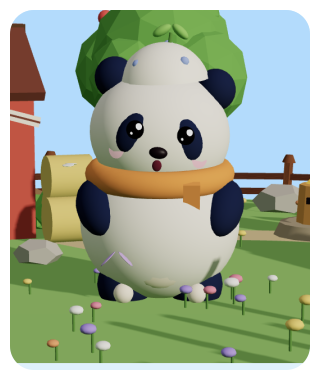
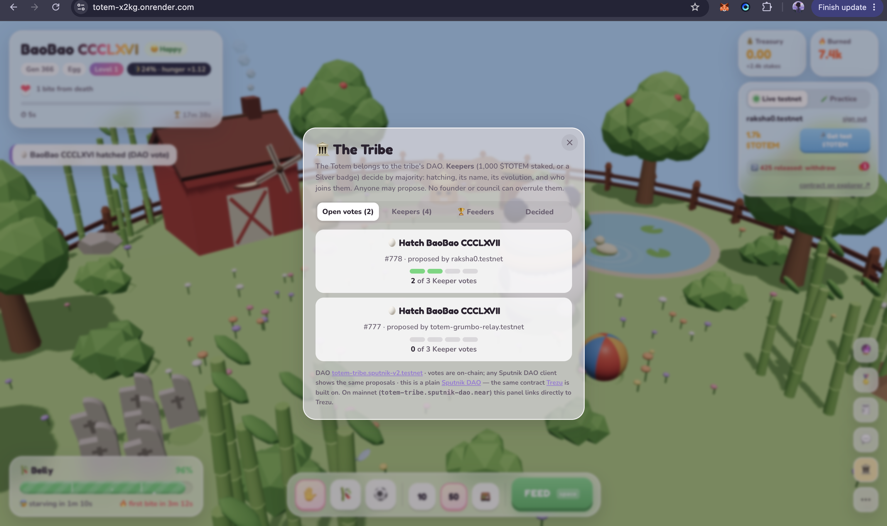

# TOTEM — BaoBao's Story

---

## 🐼 Meet BaoBao

*This is BaoBao. A community panda living on NEAR — not owned by anyone, kept alive by everyone. One creature, one tribe, one chain.*

---

## 🌙 The World Runs on the Real Moon

*BaoBao's island follows the real lunar cycle — computed from block timestamps, no oracle, no admin. Tonight: waxing crescent, 24% lit. The fuller the moon, the hungrier BaoBao gets. Feed under a full moon and earn a soulbound Moonlit badge.*

---

## 🎋 You Feed It. It Burns Half Forever.

*Every feed burns 50–70% of $TOTEM permanently and sends the rest into a keyless treasury sub-account — no one can sign for it, not even the founders. BaoBao owns its own money.*

---

## 💬 Ask BaoBao Anything

*BaoBao reads its own live chain state and answers in character via NEAR AI Cloud. Ask "Who feeds you the most?" — it names the wallet and the exact amount. Ask "How are you feeling?" — it tells you its real belly percentage. Its personality shifts every generation based on who fed the last life most.*

---

## 🔴 Neglect It and It Rampages

*Stop feeding and the island turns red. BaoBao rages — every bite burns 15% of the treasury and knocks a block off the totem pole. The tribe has one choice: rescue it or watch it die. Poke for a tip — trigger the next bite early and earn a cut of the burn.*

---

## 🔮 The Tribe Bets on Life or Death

*The moment a Rampage starts, an on-chain prediction market opens. Bet $TOTEM on survive or die. Winners split 97% of the losing pool. 3% is burned. No house edge. No backend. Settled entirely by the contract.*

---

## 📢 One Link Rescues BaoBao

*Anyone can share a rescue link to X or Telegram. Whoever opens it feeds BaoBao in one tap — no wallet, no gas, the game pays. The tribe mobilises. BaoBao survives.*

---

## ⚰️ But Sometimes It Dies

*BaoBao CCCLXV starved at Level 0. A gravestone NFT joins the lineage — permanent, on-chain, drawn by the contract itself. The island goes quiet. Only the tribe can bring it back.*

---

## 🏛️ The Tribe Votes to Hatch the Next Egg

*The Totem belongs to its DAO. Keepers — anyone with 1,000 $TOTEM staked or a Silver badge — vote by majority on everything: hatching, naming, evolution, who joins them. No founder veto. No admin shortcut.*

---

## 🗳️ A Proposal Goes On-Chain

*The tribe opens a hatch proposal for BaoBao CCCLXVI. Its traits will come from the last life's top 3 feeders. The proposal is a real Sputnik DAO transaction — visible in any DAO client.*

---

## ✅ Keepers Cast Their Votes

*Proposal #777: Hatch BaoBao CCCLXVI. 0 of 3 Keeper votes cast. The relayer proposed it. The Keepers vote. The deciding vote executes `hatch()` on the contract directly — the same path, every single time.*

---

## 🐣 BaoBao Is Reborn

*2 of 3 votes in. Top left: "BaoBao CCCLXVI hatched (DAO vote)." The previous generation just came back — new traits, new colour, same soul. The cycle begins again.*

---

## 🖼️ Every Reputation Lives On-Chain Forever

*Soulbound badges drawn entirely by the contract — no server, no IPFS. Hero, Founder, Moonlit, Welcome Back, Caretaker Bronze / Silver / Gold. Earned through play, impossible to transfer. Your history on NEAR, permanent.*

---

## 🗝️ Badge Holders Get the Den

*Exclusive to badge holders. BaoBao writes a secret diary — hunger, treasury balance, moon phase, who fed it most. Badge holders post on the wall. Your badge is the key, checked on-chain every visit.*

---

## 🏆 The Leaderboard Never Lies

*Top feeders ranked by soulbound badges — earned, never bought. Pure chain state, no database, no admin. Updated live from the contract.*

---

## 📜 Every Action Is a Real Transaction

*Every feed, burn, hatch, death, bite and badge — a real NEAR transaction. Full event history, newest first, every line links to the explorer. No backend. No database. Just the chain.*

---

## 📖 Every Life Is Remembered

*Every generation BaoBao ever lived, recorded on-chain. The living Totem NFT updates its art in real time — mood, level, belly, moon phase. The top feeders of each life seed the next egg's colour traits.*
