# TOTEM — Screenshots

## 🐼 BaoBao

*BaoBao — the community panda spirit living on NEAR. One creature, one tribe, one chain.*

---

## 🌙 Night Island — The Real Moon
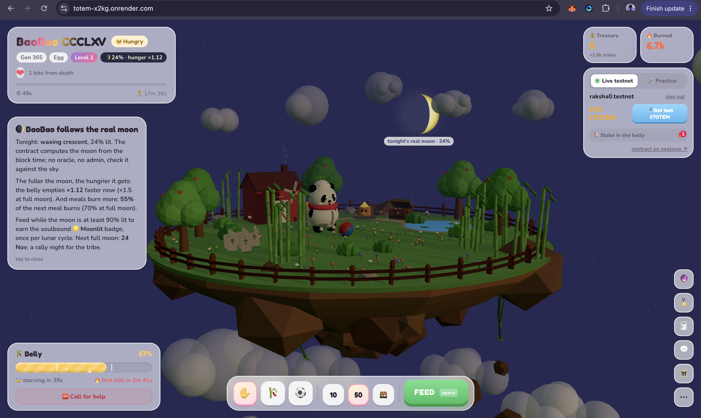
*BaoBao follows the real lunar cycle. Tonight: waxing crescent, 24% lit. The contract computes the moon phase from block timestamps — no oracle, no admin. The fuller the moon, the hungrier BaoBao gets and the more $TOTEM burns. Feed while 90%+ lit → earn the soulbound Moonlit badge.*

---

## 🎋 Feeding + Treasury
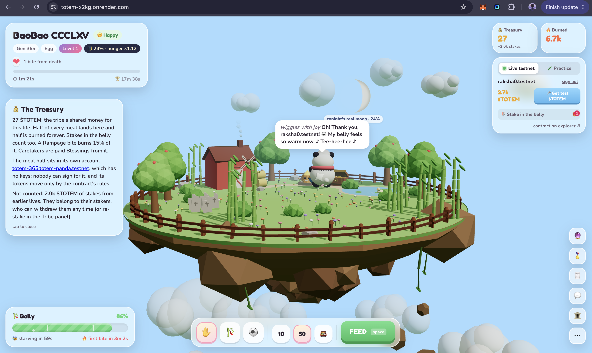
*Every feed burns 50–70% of $TOTEM forever and sends the rest into BaoBao's own treasury — a keyless NEAR sub-account nobody can sign for. BaoBao says thank you.*

---

## 🖼️ NFT Badges
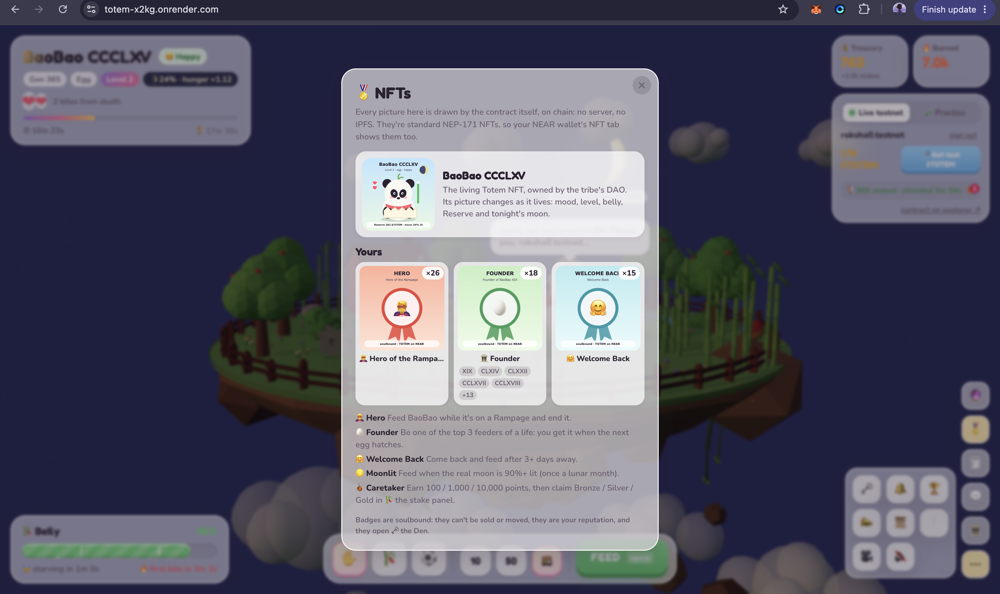
*Every picture is drawn by the contract itself, on-chain — no server, no IPFS. Soulbound badges earned through play: Hero (rescue BaoBao from Rampage), Founder (top 3 feeder of a life), Welcome Back (return after 3+ days), Moonlit (feed under a full moon), Caretaker Bronze / Silver / Gold. Badges can never be transferred — they are your reputation on NEAR forever.*

---

## 🗝️ The Den
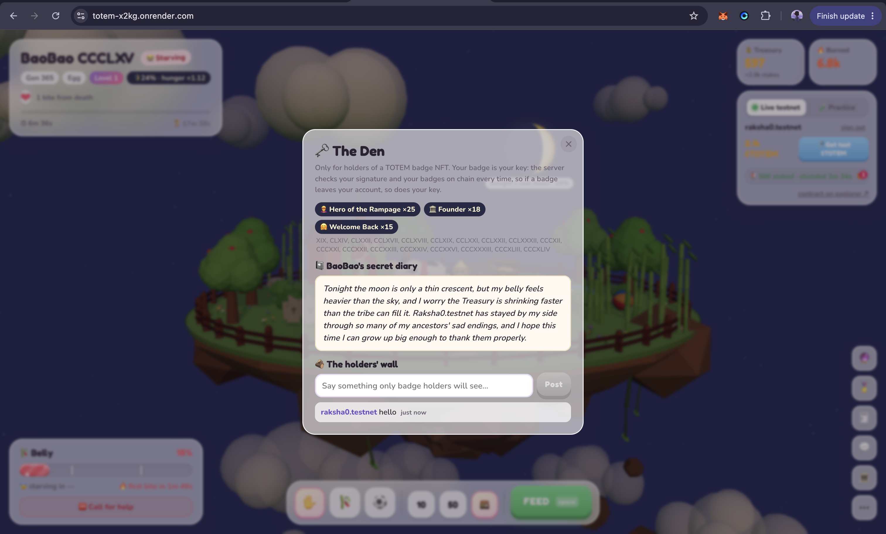
*Exclusive to badge holders. BaoBao writes a secret diary powered by NEAR AI Cloud, reading its own chain state — hunger, treasury, moon phase, top feeders. Badge holders post on the holders wall. Your badge is your key, checked on-chain every time.*

---

## 📢 Share the Totem
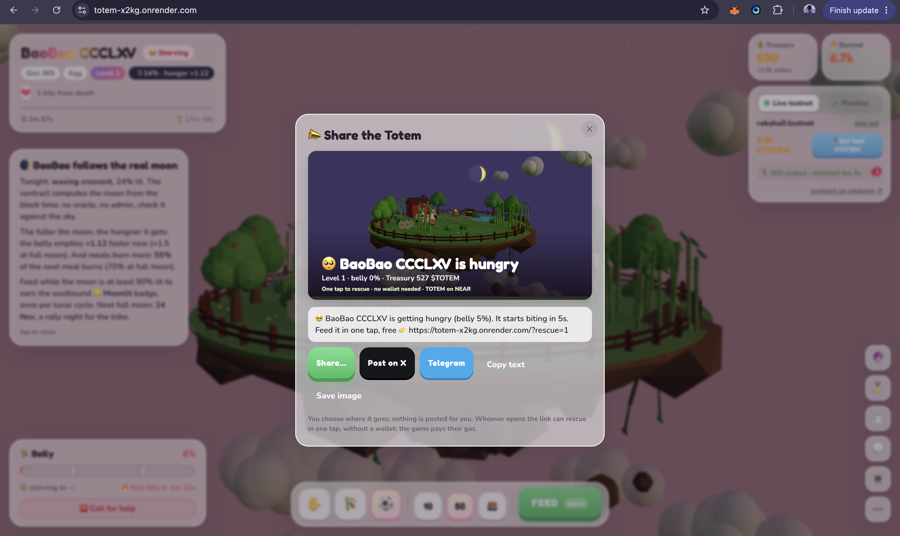
*When BaoBao is close to death, anyone can share a rescue link — Post on X, send to Telegram, copy text. Whoever opens the link can rescue BaoBao in one tap, with no wallet and no gas. The game pays their gas.*

---

## 🔮 Prediction Market
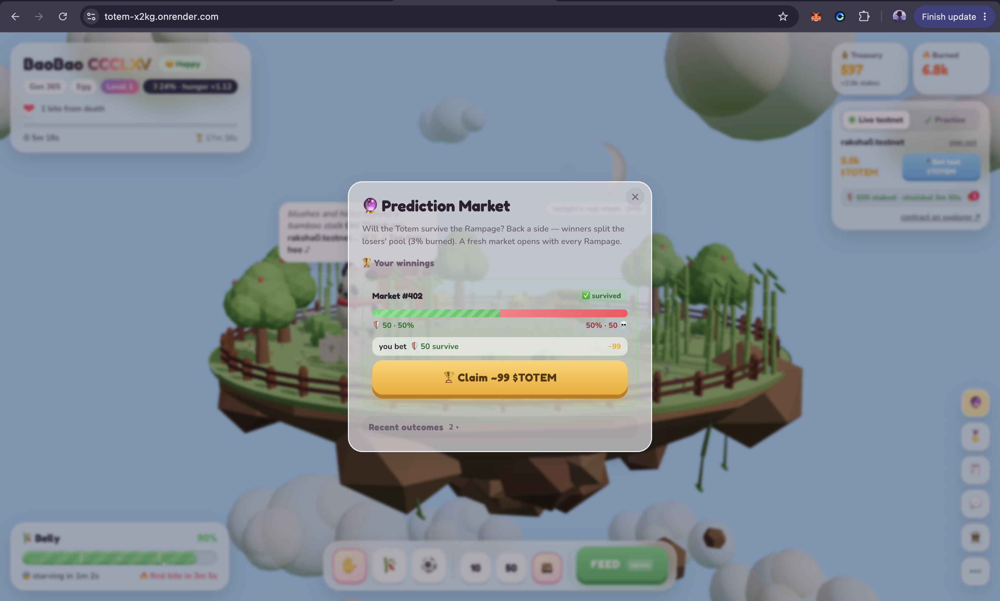
*During every Rampage an on-chain prediction market opens automatically. Bet $TOTEM on survive or die. Winners split 97% of the losing pool. 3% is burned. No house. No backend. Settled entirely on NEAR.*

---

## 🏆 Badge Leaderboard
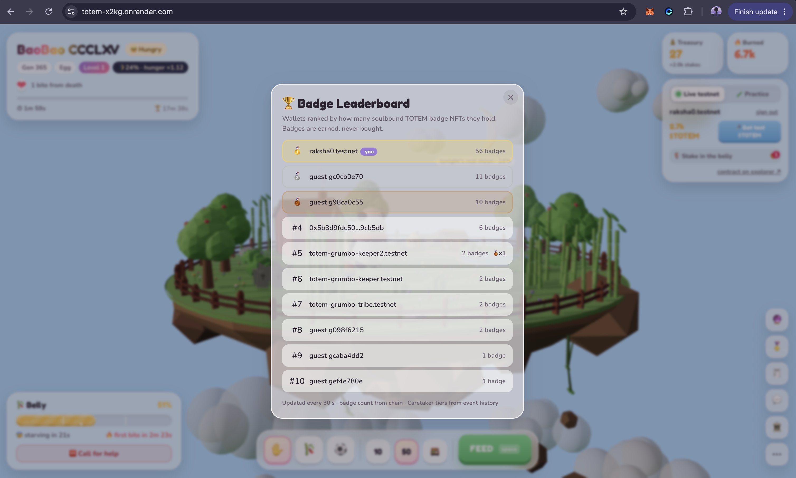
*Top feeders ranked by soulbound badges — earned, never bought. Pure chain state, no database. Updated live from the contract.*

---

## 📜 On-Chain History
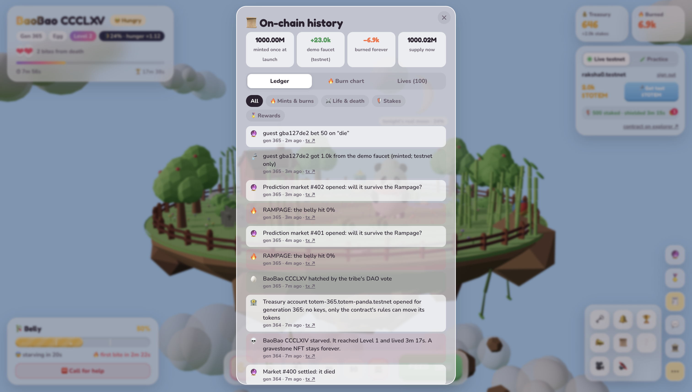
*Every feed, burn, hatch, death, Rampage and prediction market bet is a real NEAR transaction. Full on-chain event history — every line links directly to the explorer. No backend storage.*

---

## 📖 Lives Tab
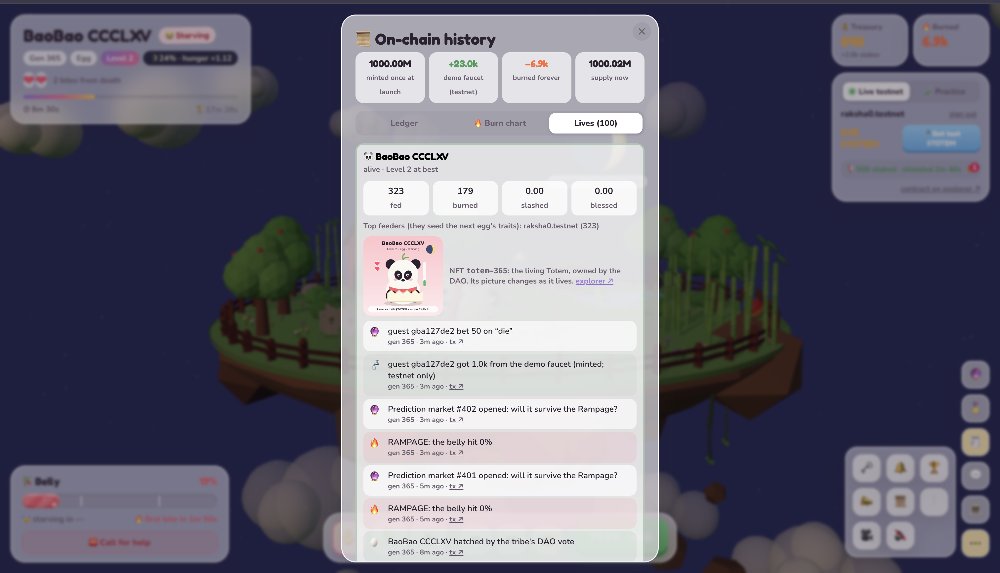
*Every generation BaoBao ever lived is recorded on-chain. The living Totem NFT updates its art in real time — mood, level, belly, moon phase. Top feeders of each life seed the next egg's colour traits.*

---

## 🔮 Prediction Market + Moon
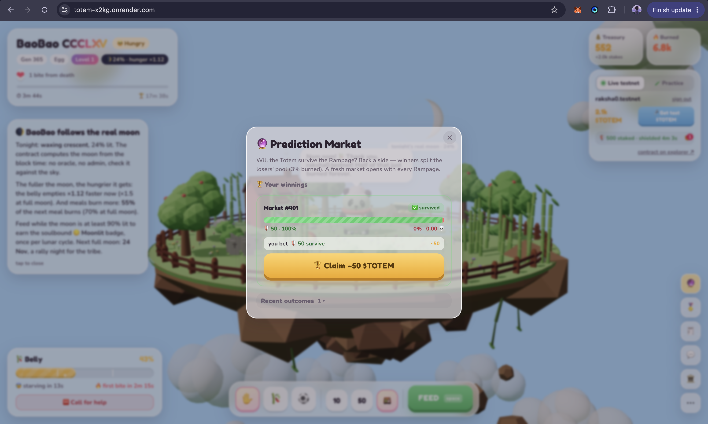
*The prediction market runs alongside the moon panel. Bet $TOTEM on survive or die, claim winnings after the Rampage resolves.*

---

## 🤖 AI Chat — Talk to BaoBao
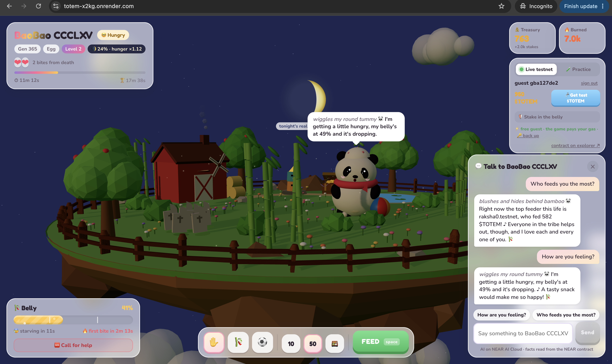
*BaoBao reads its own live chain state — belly level, treasury, moon phase, top feeders — and answers in character via NEAR AI Cloud. Ask "Who feeds you the most?" and it tells you the top feeder's wallet and exact amount. Ask "How are you feeling?" and it reports its real belly percentage. The personality shifts every generation based on who fed the previous life most.*

---

## 🔴 Rampage
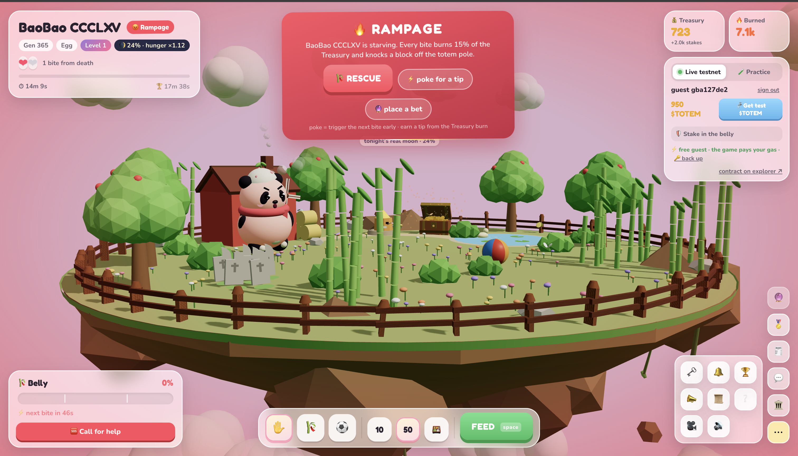
*Neglect BaoBao and it enters Rampage — the island turns pink, BaoBao rages. Every bite burns 15% of the Treasury and knocks a block off the totem pole. The tribe has one choice: RESCUE or let it die. Poke for a tip — trigger the next bite early and earn a cut of the Treasury burn. One bite from death.*

---

## 🏛️ The Tribe — Sputnik DAO
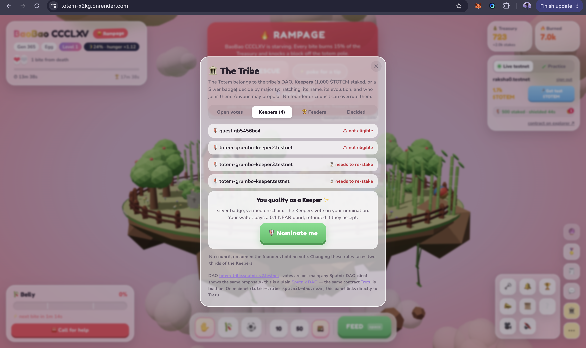
*The Totem belongs to the tribe's DAO. Keepers (1,000 $TOTEM staked or a Silver badge) decide by majority: hatching, naming, evolution, who joins them. No council, no admin, no founder veto. Changing the rules takes two thirds of the Keepers. You qualify as a Keeper — nominate yourself on-chain.*

---

## ⚰️ Death — Gravestone NFT
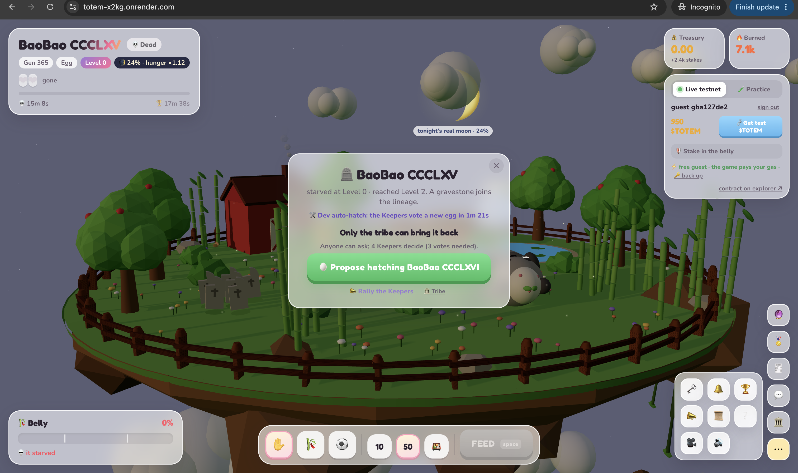
*BaoBao CCCLXV starved at Level 0. A gravestone NFT joins the lineage — permanent, on-chain, drawn by the contract itself. The island is empty. Only the tribe can bring it back. Anyone can propose. 4 Keepers decide.*

---

## 🗳️ Propose the Hatch
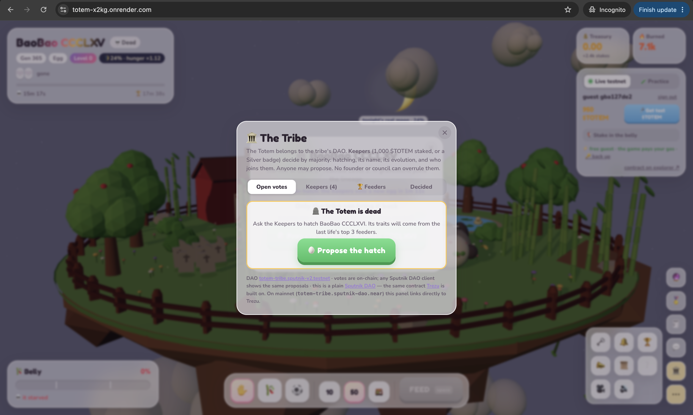
*The Totem is dead. The tribe opens The Tribe panel and proposes hatching BaoBao CCCLXVI. Its traits will come from the last life's top 3 feeders. Any Sputnik DAO client shows the same proposals — votes are fully on-chain.*

---

## ✅ DAO Vote — Hatch in Progress
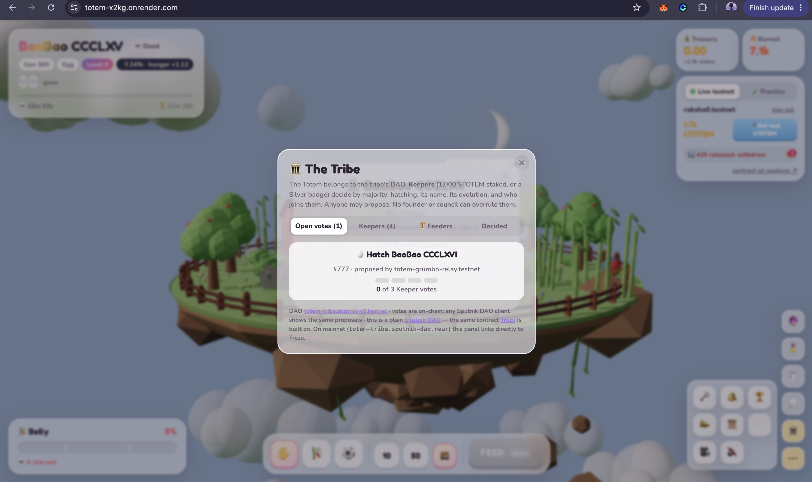
*Proposal #777: Hatch BaoBao CCCLXVI. 0 of 3 Keeper votes cast. The relayer proposed it, the Keepers vote, the DAO executes hatch() on the contract. No admin shortcut — the same governance path every time.*
